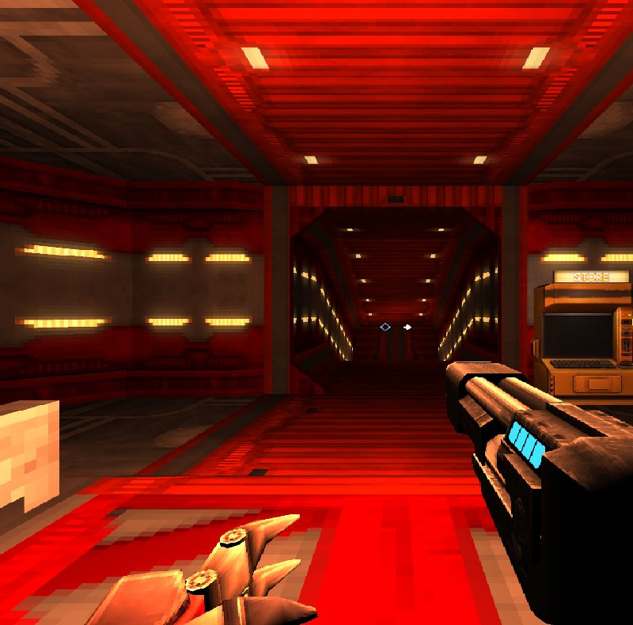
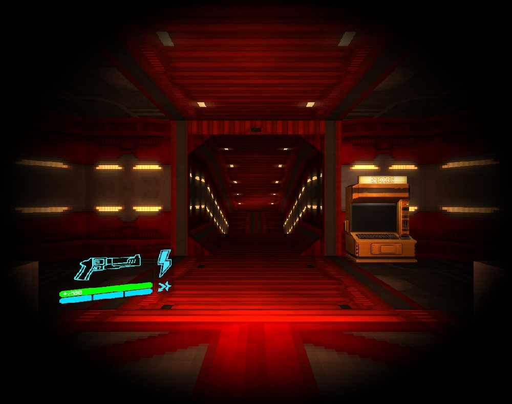

# VRTRAKILL


Play ULTRAKILL in VR. You aim with your hands, punch by swinging your fist, throw the whiplash from your other hand and read your health on your wrist. It runs on the current Steam version of the game, through SteamVR, on PS VR2, Quest, Index, Steam Frame, Pico and more.



This version runs on ULTRAKILL build 22957324 (Unity 2022.3.29f1), the current one on Steam. You do not need to downgrade the game. It was built and tested on that build only. If Steam updates the game, the mod can break until it gets an update.

## Contents

- [Features](#features)
- [Requirements](#requirements)
- [Install](#install)
- [Headsets](#headsets)
- [Controls](#controls)
- [Settings](#settings)
- [Troubleshooting](#troubleshooting)
- [Updating](#updating)
- [Uninstall](#uninstall)
- [Building from source](#building-from-source)
- [Credits](#credits)
- [License](#license)

## Features

- **Your hands are the weapons.** Guns sit in your gun hand and shoot where you point. The crosshair sits on the real shot line. Punch by swinging your fist, or with the button alone if you prefer.
- **The arm in your other hand.** The Feedbacker and Knuckleblaster punch from it, the whiplash throws from it with a small marker where it will go, and a coin tossed with a throwing move flies along your throw.
- **Health and stamina on your wrist.** Raise your arm like reading a watch, or keep the HUD floating in the view.
- **Prompts name your controller's buttons.** The game says "Cross" on PS VR2, "A" on Quest, "D-pad down" on Steam Frame, and so on.
- **PS VR2 adaptive triggers.** With the [PSVR2 Toolkit](https://github.com/BnuuySolutions/PSVR2Toolkit) installed, each weapon has its own trigger feel: a crisp break on the revolver, a heavy one on the shotgun, a rattle on the nailgun. The trigger follows the weapon's state: heavier as a charge builds, a hum when it is charged, stiff while it cannot fire. The same Toolkit gives eye tracking: parried projectiles go where your eyes look.
- **Layouts for every common controller.** PS VR2 Sense, Quest Touch, Index, Steam Frame, Pico, Vive wands and WMR, each with a mirrored left-handed layout.
- **VR settings in the pause menu.** Turning, comfort vignette, HUD, rumble, height, punch mode and left-handed play, changed in the headset.
- **Controller feedback.** Each hand rumbles on its own: gunfire in the gun hand, punches and the whiplash in the other, a tick when a hit lands, a sharp crack and a deep knock on a parry, a knock on a kill, a thud when you get hurt, and a heartbeat when your health is low.
- **Comfort options.** Snap or smooth turning, an optional vignette while moving fast, adjustable movement speed. Seated or standing play: your head is put at the game's eye height at each level.
- **No window juggling.** The buttons work while another window has focus, and they never reach Windows or other programs.
- **Full frame rate.** The desktop frame cap and vsync are off while VR runs, so the game keeps up with a 90 or 120 Hz headset.
- **A streamer view for recording.** Press `T`, or turn on STREAMER VIEW in the VR column, and the monitor shows a smoothed, level 16:9 view at 60 frames a second instead of the shaky headset mirror, with a HUD, and on PS VR2 a ring where your eyes look and the path of eye-aimed parries. The headset keeps its frame rate. Recording tips are in [docs/STREAMING.md](docs/STREAMING.md).
- **VR starts by itself** as soon as SteamVR sees the headset. While it is not running, the game window on your monitor says why.

The full list of changes is in [CHANGELOG.md](CHANGELOG.md).

## Requirements

- ULTRAKILL on Steam, build 22957324.
- SteamVR. The mod uses OpenVR only, so every headset goes through SteamVR. The active OpenXR runtime does not matter.
- A headset from the [list below](#headsets).

## Install

### With a mod manager (r2modman, Gale)

Install VRTRAKILL from the mod manager, start SteamVR, then start the game with "Start modded". The steps and the files the mod copies into the game folder are in [thunderstore/README.md](thunderstore/README.md).

### By hand

Get the latest release from the [Releases page](../../releases). There are two zips:

- `VRTRAKILL-<version>-full.zip`: the mod plus BepInEx 5.4.23.5 (x64). Use this one if you have never installed BepInEx.
- `VRTRAKILL-<version>-modonly.zip`: the mod only, for players who already have BepInEx 5.4.23.5.

1. Close ULTRAKILL.
2. In Steam, right-click ULTRAKILL, then Manage > Browse local files. This opens the folder that has `ULTRAKILL.exe`.
3. Extract the zip into that folder. If Windows asks to replace or merge files, say yes.
4. Start SteamVR and connect your headset.
5. Start ULTRAKILL from Steam.

On the first start, `BepInEx/patchers/VRPatcher.dll` edits `ULTRAKILL_Data/globalgamemanagers` to turn on VR. It keeps the original as `globalgamemanagers.vrtrakill.bak`. When a game update replaces that file, the patcher patches the new one on the next start.

If you downgraded the game for an older VRTRAKILL, switch it back to the current version first: right-click ULTRAKILL > Properties > Betas, and select None.

## Headsets

| Headset | Status |
|---|---|
| PlayStation VR2 (PC adapter) | Tested |
| Meta Quest 2, 3, 3S, Pro | Tested |
| Valve Index | Configured |
| Steam Frame | Configured |
| Pico 4, Pico 4 Ultra | Configured |
| HTC Vive, Vive Pro | Configured |
| Windows Mixed Reality | Configured |
| HTC Vive Cosmos controllers, Logitech VR Ink, hand tracking | Not supported |

"Tested" means it was played on hardware through SteamVR. "Configured" means the default layout covers every game action and was checked against the SteamVR driver's input profile, but nobody has played with it yet. Reports from players with these headsets are welcome.

How to connect each headset (PS VR2 adapter, Quest Link, Virtual Desktop, Steam Link, PICO Connect) and the button map of every controller are in [docs/HEADSETS.md](docs/HEADSETS.md).

## Controls

(R) is the right controller, (L) is the left controller. The game's own prompts and hints name the button on your controller, so you can also follow them. Other controllers are in [docs/HEADSETS.md](docs/HEADSETS.md#button-maps). You can change any binding in SteamVR > Settings > Controllers > Manage Controller Bindings > ULTRAKILL.

| Action | PS VR2 Sense | Quest Touch (and Pico) |
|---|---|---|
| Move | (L) stick | (L) stick |
| Turn | (R) stick left or right | (R) stick left or right |
| Jump | (R) Cross | (R) A |
| Slide / slam | (R) stick click | (R) stick click |
| Dash | (L) stick click | (L) stick click |
| Shoot | (R) R2 | (R) trigger |
| Alternate fire | (R) R1 | (R) grip |
| Punch | (L) L2 | (L) trigger |
| Whiplash | (L) L1 | (L) grip |
| Change fist (Feedbacker / Knuckleblaster) | (L) Square | (L) X |
| Change weapon variation | (L) Triangle | (L) Y |
| Weapon wheel | Hold (R) Circle, aim with the (L) stick, let go to switch | Hold (R) B, aim with the (L) stick, let go to switch |
| Pause | (R) Options, or double tap (R) Circle | Double tap (R) B |
| Menu: select | Point a controller and pull its trigger, or (R) Cross on the highlighted item | Point a controller and pull its trigger, or (R) A on the highlighted item |
| Menu: move the highlight | (L) stick | (L) stick |
| Menu: scroll | (R) stick up or down | (R) stick up or down |
| Menu: back | Press (R) Circle once | Press (R) B once |

- The right stick only turns. Pushing it up or down does nothing, and no button switches to the next weapon: use the weapon wheel.
- A single press of (R) Circle or (R) B does nothing in play, so the button only pauses on a double tap. In a menu, one press goes back one page.
- In menus the select buttons do not jump, shoot or punch, also when the menu closes while you hold them. In a shop, the jump button on a shop button clicks it.
- PS VR2: (L) Create is not used, SteamVR takes it for screenshots. Quest: the (L) menu button opens the SteamVR menu, games cannot use it.
- With `Left handed` on, every button and stick swaps sides: you shoot with the left trigger, move with the right stick and turn with the left. On PS VR2, Cross becomes Square, Circle becomes Triangle and Options becomes Create. On Quest, A becomes X and B becomes Y. The prompts follow.

If the buttons act like an older version, pick the default layout again: SteamVR > Settings > Controllers > Manage Controller Bindings > ULTRAKILL > Default.

## Settings

Pause the game in the headset. A **VR** column next to the pause menu changes the main settings at once and saves them: a comfort preset, the streamer view, turn mode (smooth, or snap 30, 45 or 90 degrees), turn speed, UI size, comfort vignette, screen flashes, HUD on the wrist or floating, rumble strength, height offset, recenter view, adaptive triggers, fingers, punch by swing or by button, left handed (takes effect after a restart), and the cheat menu (CHEATS: the sandbox tools and the other cheats, which the game opens with keyboard keys). Point the laser at a button and pull the trigger to move to the next value.

**COMFORT** sets several settings at once. Start with **BEGINNER** if you are new to VR or fast games make you sick, and move up when you feel ready:

| Preset | Turning | Comfort vignette | Screen flashes | Weapon charge shake |
|---|---|---|---|---|
| BEGINNER | snap 45° | on (0.95) | off | none |
| STANDARD (default) | smooth 300°/s | off | reduced | a tenth |
| ULTRAKILL | smooth 360°/s | off | full | the game's |

Changing one of these settings yourself shows CUSTOM. Movement and jump speed are never changed by a preset.



All settings are in `BepInEx/plugins/VRTRAKILL/VRTRAKILL_Config.json`. Close the game before you edit the file. The ones players ask about most:

| Setting | Default | What it does |
|---|---|---|
| `Movement multiplier` | `1.0` | Walk speed. 1 is the game's speed. Lower it if fast movement makes you sick; jumps are not affected. |
| `Jump multiplier` | `1.0` | Jump and wall jump power. Below 1 some jumps in the levels cannot be made. |
| `Auto height` | `true` | At the start of each level, your head is put at the game's own eye height, whatever your real height, seated or standing. Crouching and leaning stay real. Press `H` ("Recalibrate height" in the keybinds) to measure again while you play. `false` uses your real height above the floor. |
| `Height offset (meters)` | `0.0` | Moves the view and the hands up (positive) or down (negative), on top of auto height. `BepInEx/LogOutput.log` prints your eye height at the first level. |
| `Enable movement-based punching` | `true` | `true`: hold punch and swing your fist. `false`: the punch button alone punches, like the flat game. |
| `Required speed to punch` | `4.0` | Twice the hand speed in m/s that a swing needs (4 = 2 m/s). Lower it if punches do not register. |
| `Coin follows the throw` | `true` | A coin (Marksman revolver) leaves your arm hand, and one tossed while your arm hand makes a throwing move flies along the throw, harder for a harder throw. A still hand tosses it as the game does. |
| `Parry aim` | `"Eyes"` | Where a parried projectile, cannonball or nail goes. `"Eyes"`: where your eyes look, on PS VR2 with the PSVR2 Toolkit; elsewhere, or when the eyes are not tracked, where your head looks. `"Head"`: where your head looks, like the flat game's camera. An enemy within half a metre of that line is hit. `"Hand"`: along your arm hand. The game's auto-aim still applies on top. |
| `Snap turning` / `Smooth turning speed` | `false` / `300` | Snap or smooth turning on the right stick. |
| `HUD on wrist` | `true` | Health, stamina and the weapon panel sit on your arm-hand forearm, facing you, like a watch. `false` brings back the panel floating low in the view. |
| `UI Size (from 0 to 0.1)` | `0.04` | Size of the menus and the floating HUD: 0.04 spans about 56 degrees of your view. Raise it for bigger text, lower it if the edges are hard to read. "UI size" in the VR column changes it in the headset. |
| `Whiplash aim marker` | `true` | A small blue marker ahead of the arm hand where the whiplash will go, while it is ready to throw. |
| `Left handed` | `false` | Puts the guns in the left hand and the arm in the right hand, and mirrors the buttons (see Controls). Takes effect the next time VR starts. A layout you made yourself in SteamVR's binding screen still wins; pick the default there to get the mirrored one. |
| `Comfort vignette` | `false` | Darkens the edge of the view while you move fast, dash, slam, fall fast, get launched, or turn with the stick. Turn it on if the game makes you feel sick. `Comfort vignette strength` (0 to 1, default 0.85) sets how dark. |
| `Screen flashes` | `"Reduced"` | The white flash of a parry and the red flash of damage cover the whole view in VR. `"Reduced"` keeps them faint, `"Off"` hides them, `"Full"` shows them as the game draws them. `"Reduced"` and `"Off"` also soften explosions: no white first frame, a fainter sphere, half the light. Fades to black are not changed. |
| `Low health warning` | `true` | Below 30 health, both hands feel a heartbeat that quickens near death, and the edge of the view glows dark red with each beat (not with `"Screen flashes"` off). |
| `Weapon charge shake` | `0.1` | How much of the game's shake a charging weapon keeps, from 0 (steady) to 1 (the game's). The full shake moves the gun up to 2 cm every frame, a rattle in your hand in VR. |
| `Rumble strength` | `1.0` | Scales all controller vibration, from 0 to 2. The game's own rumble setting still applies on top. |
| `Hit and kill rumble` / `Damage rumble` / `Menu rumble` | `true` | The tick when your shot or punch lands, the crack and knock of a parry, and the knock on a kill; the thud when you get hurt; the tick when the menu laser reaches or presses a button. |
| `Parry warning` | `true` | A tick in the arm hand when an enemy projectile you can parry comes within reach of the punch (Feedbacker only): punch now. |
| `Adaptive triggers` | `true` | PS VR2 only, with the PSVR2 Toolkit installed: the gun trigger's resistance follows the weapon and its state (heavier while charging, a hum when charged, stiff while it cannot fire), and the punch trigger the fist. Menus, the shop and pause free both triggers. Without the Toolkit nothing happens. On PS VR2, R2 and L2 act at three quarters of their travel, just past each break, with or without the Toolkit. |
| `Finger tracking` | `false` | The arm hand's fingers follow yours, from the controller's finger sensors. "Fingers" in the VR column switches it at once. |
| `Windows key presses` | `false` | `false`: the VR buttons press a keyboard and mouse that exist only inside the game. `true`: real Windows key presses, like 1.0.x, which need the ULTRAKILL window in front. Use it only if a button does nothing with `false`, and report it. |
| `Streamer view` › `On` | `false` | What the monitor shows. `false`: the headset mirror (one eye, it moves with every head movement). `true`: the streamer view, a camera at the middle of your eyes with smoothed head turns and a level horizon, made for recording and streaming. `T` ("Toggle streamer view", with the game window in front) or STREAMER VIEW in the VR column switches it. |
| `Field of view (horizontal degrees)` / `Turn smoothing` / `Level horizon (0 to 1)` | `90` / `"Medium"` / `1.0` | The streamer view's field of view; how much head turns are smoothed (`"Off"`, `"Low"`, `"Medium"`, `"High"`; fast turns are always smoothed less, so a quick look stays readable); how level the horizon stays (1 always level, 0 rolls with your head). |
| `Frame rate (0 = headset rate)` / `Height in pixels` | `60` / `1080` | How often the streamer view is drawn and how big: 60 is every second frame on a 120 Hz headset (on 90 Hz, 45 or 90 divide evenly). A picture of 1080 is 1920x1080, letterboxed to the window. Lower values cost the headset less. |
| `HUD` / `Overlay` | `"Medium"` / `"Always"` | Drawn on the streamer view only, never in the headset. `HUD`: health, stamina, the weapon in hand, and the style rank with its freshness and bonus list (`"Off"`, `"Small"`, `"Medium"`, `"Large"`), since in VR they sit on your wrist and at the edge of your view; the game's floating style panel is then left out of the streamer picture. `Overlay` (OVERLAY in the VR column): `"Always"` shows where your eyes look (PS VR2 with the PSVR2 Toolkit), the path of each eye-aimed parry, the parry warning and what the triggers feel like when it changes (R2 CHARGE 2/4, READY, LOCKED); `"Parries"` only around parries; `"Off"` nothing. |

When you update from an older version, the mod changes the old defaults in your file once (movement multiplier 0.575 to 1.0, punch speed 7.5 to 4.0) and adds the new settings. Values you changed yourself are kept.

## Troubleshooting

While VR is not running, a box at the top of the game window on your monitor says why:

- "SteamVR is not running": start SteamVR (PS VR2: start the PlayStation VR2 App). If SteamVR is not running when the game starts, the game starts it itself, like any VR game.
- "SteamVR sees the headset. Starting VR in a few seconds...": SteamVR has just started; VR waits a moment so SteamVR's own apps (Home, Room Setup) do not take it away.
- "SteamVR stopped VR for ULTRAKILL": another VR app started or SteamVR closed. Restart ULTRAKILL.
- "SteamVR is not answering": SteamVR is stuck, often on "Unexpected SteamVR Error" because the headset is not connected. Connect and turn on the headset, then restart SteamVR; the game keeps waiting.
- "SteamVR does not see a headset": turn the headset on. For PS VR2, start the PlayStation VR2 App and wait until it shows the headset as connected.
- "ULTRAKILL was updated (build ...)": the game build is not the one this release was tested on. The mod still starts, but some VR features may not work.

VR starts by itself as soon as SteamVR sees the headset; you do not need to restart the game.

Other problems:

- Buttons do nothing: check that `BepInEx/LogOutput.log` says "VR buttons go to a virtual keyboard and mouse inside the game". If you turned on `Windows key presses`, click the ULTRAKILL window on your monitor so it has focus.
- Buttons act like an old layout: SteamVR > Settings > Controllers > Manage Controller Bindings > ULTRAKILL > Default.
- Punches do not register: lower `Required speed to punch`, or set `Enable movement-based punching` to `false` to punch with the button alone.
- A hand drifts or flies away (PS VR2): the headset's cameras lost the controller. The mod keeps that hand near you until it is found again. If it happens often, see the tracking tips in [docs/HEADSETS.md](docs/HEADSETS.md#known-issues).
- You feel too tall or too short: stand or sit as you play and use "Recenter view" in the VR column of the pause menu (or press `H`), or change the height offset there.

### Reporting a bug

Open an [issue](../../issues/new/choose) with the mod and game versions, your headset and how it connects to the PC, and what happened. Attach these two logs, from the session where the problem happened:

- `BepInEx/LogOutput.log` in the game folder (in a mod manager: the profile folder).
- `%USERPROFILE%\AppData\LocalLow\Hakita\ULTRAKILL\Player.log`

## Updating

Extract the new zip over the old install, or update in your mod manager. Files from older versions can stay. If SteamVR keeps an old layout, pick the default layout again (see [Controls](#controls)).

Once per game start, the mod asks GitHub whether a newer VRTRAKILL release exists and shows a notice in the main menu if so. It sends one plain request with no personal data, and downloads nothing unless you set `"Auto update"` to `"Download"`; `"Off"` turns the check off. What the check sends and how a signed update is installed are in [docs/UPDATER.md](docs/UPDATER.md).

## Playing without VR

To play flat on the monitor without uninstalling the mod, add `--novr` to the game's launch options: in Steam, right-click ULTRAKILL > Properties > General > Launch options. The mod then changes nothing for that session (`BepInEx/LogOutput.log` says so). Remove `--novr` to play in VR again.

## Uninstall

1. Close ULTRAKILL.
2. If no other mods use BepInEx, delete the `BepInEx` folder and the doorstop files `winhttp.dll`, `doorstop_config.ini` and `.doorstop_version` from the game folder. If you have other BepInEx mods, keep those and delete only `BepInEx/plugins/VRTRAKILL/` and this mod's three files in `BepInEx/patchers/` (`VRPatcher.dll`, `AssetsTools.NET.dll`, `classdata.tpk`). Also delete `BepInEx/VRTRAKILL_update/` if it exists.
3. In Steam, right-click ULTRAKILL > Properties > Installed Files > Verify integrity of game files. This restores the original `globalgamemanagers`, which turns VR off.

The other files the zip added under `ULTRAKILL_Data` can stay. Only the mod starts OpenVR, so without it they are not used. For a mod manager install, see [thunderstore/README.md](thunderstore/README.md#uninstall).

## Building from source

You need a .NET SDK (7.0.400 or later) and ULTRAKILL build 22957324 with BepInEx 5.4.23.5 installed. The game's DLLs are not in this repository; the build reads them from your game folder.

```
pwsh tools/setup-dev.ps1 -ULTRAKILLDir "<game folder>"
dotnet build VRTRAKILL.sln -c Release -p:ULTRAKILLDir="<game folder>"
```

Setup, testing in the game, the in-game test hooks, the left-handed layout generator and packaging are in [docs/BUILDING.md](docs/BUILDING.md).

## Credits

- whateverusername0 created VRTRAKILL ([original repo](https://github.com/whateverusername0/VRTRAKILL)). The original README put development on indefinite hold and pointed players to forks for newer game versions. This is one of those forks.
- Squaresweets (Matthew Collier) made the [VRTRAKILL_FRAUD](https://github.com/Squaresweets/VRTRAKILL_FRAUD) fork. This version builds on it.
- Guillaume-Lechevallier: thank you for your [VRTRAKILL_FRAUD fork](https://github.com/Guillaume-Lechevallier/VRTRAKILL_FRAUD), which did the groundwork for the current game build (the Unity 2022.3 VRPatcher, the OpenVR start-up and the portal overlay). Our weapon wheel, desktop view, 4-S and Clash camera, late HUD conversion and opt-in VR body are based on your work, and your notes pointed us at the shop preview problem.
- Graze, Rokic, Party Wumpus and NavaShield contributed to the original mod.
- Raicuparta: the globalgamemanagers patcher approach comes from Two Forks VR (MIT).
- BnuuySolutions: the [PSVR2 Toolkit](https://github.com/BnuuySolutions/PSVR2Toolkit) (MIT) opens the PS VR2 Sense adaptive triggers and the headset's eye tracking on PC; the mod sends its trigger effects to it and reads the gaze from it.
- Motaweh updated the mod for build 22957324 (1.0.x).
- NathanKneT made version 2.0.0: the fixes for the problems players reported most, buttons inside the game, controller layouts and button prompts, left-handed play, controller feedback, settings in the headset and the comfort vignette.

## License

AGPL-3.0. See [LICENSE.md](LICENSE.md). Modified by Motaweh and NathanKneT, 2026.

Third-party files (BepInEx, UnityDoorstop, SteamVR plugin, OpenVR, Unity XR packages, AssetsTools.NET, Newtonsoft.Json and others) keep their own licenses. See [THIRD_PARTY_NOTICES.md](THIRD_PARTY_NOTICES.md).

This is a fan project. It is not made by or connected to New Blood. You need your own copy of ULTRAKILL.
